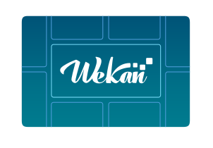

<p align="center"></p>

# wekan-steps

[](https://github.com/webship/wekan-steps/actions/workflows/test.yml)

Cucumber step definitions for testing Wekan, the open-source kanban board, with
[webship-js](https://webship.co/docs/webship-js/2.0.x), a BDD browser automation harness built on Playwright and
Cucumber-js. The pack covers what a board's work goes through:

- **signing in and out**: an account of the users registry by its handle, the sign-in form, a refused sign-in, who
  the session is, signing out;
- **a board**: its lists and their cards, opened by its title, and refused to an account the board does not have;
- **a new card** added to a list the way a person does;
- **one card** in its panel: its list, a comment, a label, its assignee, who made it, its checklist and the time
  logged on it, each through its own control, a move to another list, and archiving;
- **the board's sprints**: the active sprint of its Scrum planning, and the cards in it;
- **what an account may not do**: a read-only member neither changes a card, nor comments on it, nor adds one, and an
  account the board does not have is told it is not found.

The steps make and remove their test content through the site's own REST API, as a managing account (the board's
administrator) with its username and password, apart from the browser: a card a scenario makes goes after it, so a run
leaves the site as it found it.

No step phrase names the platform: a scenario reads `When I move the card to the list "Done"` and
`Then the card should have the label "bug"`.

CI builds a real Wekan site with [DDEV](https://ddev.com) on the runner (Wekan's own image on the project's own
MongoDB 7, the accounts of the suite in their roles of the sample board, the sample content), runs the whole suite
against it twice on every push and pull request, checks after each run that the site holds what it held before, then
runs the assertions that must fail; see [The test site](#the-test-site) and
[`.github/workflows/test.yml`](.github/workflows/test.yml).

## Signing in first

Every feature starts by signing in: an account of the users registry, by its handle.

| Step | What it does |
| --- | --- |
| `Given I am a logged in user with the "member" user` | Signs in as an account of the users registry, by its handle. The first time in a run through the sign-in form, then its session is put back |
| `When I log in with the "member" user` | Fills and submits the sign-in form with the account's username and password, and waits until the session is the account's |
| `When I log in as "member" with the password "wrong"` | Fills and submits the sign-in form with a username and a password as typed, and asserts nothing: for scenarios about the sign-in itself |
| `Given I am not logged in` | The browser forgets its session |
| `When I log out` | Signs out from the person's menu (their name, at the top right), Log Out, and waits until the session is gone |
| `Then I should be logged in as "Member Test"` | The session is the account's: its full name as the site shows it, or its username |
| `Then I should not be logged in` | The browser holds no session |
| `Then the login should be refused with "Incorrect password"` | The sign-in form stayed, with that message ("User not found" for an account the site does not have) |

```gherkin
Scenario: An account signs in through the form and out again
  Given I am not logged in
  When I log in with the "member" user
  Then I should be logged in as "Member Test"
  When I log out
  Then I should not be logged in
```

The site keeps a session in its login cookie, a login token of the person: the steps ask the site's REST API who the
session is with it, and put an account's session back (its cookie) after its first sign-in. Every login token a run
met (the browser's sessions and the managing account's) is revoked when the run ends, through the site's own
`POST /users/logout`, so a run leaves no login behind. After a page is loaded in full the site shows its sign-in page
for a moment while it takes the session back: the steps wait until it has.

## From nothing to a green run

What the machine needs: Docker, [DDEV](https://ddev.com), git, python3, Node.js 24 or later with npm, and about 1.5 GB
of free memory for Wekan and MongoDB. Wekan runs in DDEV's containers.

**1. The site.** The pack's own build script (the one CI runs) makes the site in a DDEV project: Wekan's own image
(`ghcr.io/wekan/wekan:v13.33`, `RELEASE` for another release) on the project's own MongoDB 7 (`mongo:7.0.48`), an
administrator of this site as Wekan's first account, the four accounts of [Test users](#test-users), and the sample
content (see [The test site](#the-test-site)). It takes about a minute once the images are pulled (a download of about
600 MB the first time). Wekan needs a MongoDB-compatible database, so the project runs MongoDB as its own service, a
replica set of one, as Wekan's reference setup does.

```bash
git clone https://github.com/webship/wekan-steps.git
SITE_DIR="$PWD/wekan-site" wekan-steps/.github/scripts/build-ddev-site.sh
```

The site answers at `https://wekansteps.ddev.site`. In the [Webship Workspace](https://github.com/webship/workspace),
its Wekan plugin builds the same site in a sites folder, on DDEV, and wires this pack into the testing setup of the
site:

```bash
bash core/scripts/plugins.sh --require @webship.co/workspace-wekan
bash core/scripts/plugins.sh --activate wekan --with-needs
bash core/scripts/plugins.sh --install wekan --with-needs
bash dev/cmd-wekan-project.sh wksite --install --add-users --sample-content
bash dev/cmd-tools-testing.sh wksite --run
```

**2. A test project.**

```bash
mkdir wekan-tests && cd wekan-tests
npm init -y
npm install --save-dev webship-js @webship-js/wekan-steps
npx init-webship-js
```

**3. `cucumber.js`.** Add the pack's step definitions after webship-js's own, and give the world its parameters:

```javascript
require: [
  'node_modules/webship-js/tests/step-definitions/**/*.js',
  'node_modules/@webship-js/wekan-steps/tests/step-definitions/**/*.js',
],
tags: process.env.CUCUMBER_TAGS || 'not @wip and not @must-fail',
worldParameters: {
  launchUrl: process.env.LAUNCH_URL || 'https://wekansteps.ddev.site',
  // The account that makes and removes test content through the site's API: the administrator of the boards used.
  manager: process.env.MANAGER || 'owner',
  // The board a step works in when it names none (its title).
  board: process.env.BOARD || 'Webship site',
  // The site signs in with the username, and shows the full name.
  users: {
    owner: { username: process.env.WEKAN_OWNER_USER || 'owner', password: process.env.WEKAN_OWNER_PASSWORD, name: 'Owner Test' },
    member: { username: process.env.WEKAN_MEMBER_USER || 'member', password: process.env.WEKAN_MEMBER_PASSWORD, name: 'Member Test' },
    reader: { username: process.env.WEKAN_READER_USER || 'reader', password: process.env.WEKAN_READER_PASSWORD, name: 'Reader Test' },
    stranger: { username: process.env.WEKAN_STRANGER_USER || 'stranger', password: process.env.WEKAN_STRANGER_PASSWORD, name: 'Stranger Test' },
  },
  // … webship-js's own parameters (minWaitTime, screenshot, javascript …)
},
```

This repository's own [`cucumber.js`](cucumber.js) is a whole example.

**4. Run.**

```bash
npx cucumber-js                                  # every feature
npx cucumber-js tests/features/cards.feature     # one feature
CUCUMBER_TAGS=@board npx cucumber-js             # one tag
```

## Steps

### Boards

| Step | What it does |
| --- | --- |
| `When I open the board "Webship site"` | Opens the board, by its title: its lists |
| `Then the list "Doing" should show the card "…"` / `should not show` | What a list of the open board holds: its open cards |
| `Then I should be refused the board "Webship site"` | The site says "Board not found", and shows none of its lists (`@js-off`) |

### Test content

| Step | What it does |
| --- | --- |
| `Given there is a card "Webship test …" in the list "To Do" of the board "Webship site"` | Makes it through the site's API as the managing account. It goes after the scenario |
| `Given there is no card "Webship test …" on the board "Webship site"` | Removes any open card of the title, for good |

### A new card

| Step | What it does |
| --- | --- |
| `When I add the card "Webship test …" to the list "To Do"` | Through the list's "Add Card" on the open board: its title, then Add. It goes after the scenario |

### One card

A card opens over its board (`/b/<board id>/<slug>/<card id>`), in a panel; its actions are its own controls and the
popups they open.

| Step | What it does |
| --- | --- |
| `When I open the card "…"` | Opens it by its title, on the scenario's board |
| `When I move the card to the list "Done"` | Through its List picker |
| `Then the card should be in the list "Done"` | As its panel names it under List |
| `When I add the comment "…" to the card` | Through its comment box, then Comment |
| `Then the card should show the comment "…"` (`… by "Member Test"`) | Its comments show it, written by that person when one is named |
| `When I add the label "bug" to the card` | Through its Labels popup: a label of the board's own |
| `Then the card should have the label "bug"` / `should not have` | Its labels, at the top of its panel |
| `When I assign the card to "Owner Test"` | Through its Assignee popup: a member of the board, by their full name |
| `Then the card should be assigned to "Owner Test"` | Its assignees, by their full names |
| `Then the card should be created by "Owner Test"` | Who made it, as its Creator says |
| `Then the card should have the checklist item "…"` | An item of one of its checklists |
| `Then the card should show the time "0.5 h" logged by "Member Test"` | The days of its time, in its Spent time menu: their hours and who logged them. The step logs nothing |
| `When I archive the card` | Through its Card Actions: Move Card to Archive, then the confirmation; the card leaves its board |

### The board's sprints

| Step | What it does |
| --- | --- |
| `When I open the sprints of the board "Webship site"` | The Sprints of the board's Scrum planning, through the board's view menu; the view the person had is put back after the scenario |
| `Then the sprint "Sprint 1" should be active` | The sprint list marks it "(Active)" |
| `Then the sprint "Sprint 1" should have the card "…"` | The sprint is chosen, and its table lists the card in it |

### What an account may not do

| Step | What it does |
| --- | --- |
| `Then I should not be able to add a card to the list "To Do"` | The list of the open board offers no "Add Card" (a read-only member's) |
| `Then I should not be able to change the card` | The open card's panel offers no List picker, no Labels or Assignee popup and no Spent time menu (a read-only member's) |
| `Then I should not be able to comment on the card` | The open card's panel offers no comment box (a read-only member's) |
| `Then I should be refused the board "Webship site"` | The site says "Board not found" (an account the board does not have) (`@js-off`) |

Every step carries five example phrasings in its JSDoc, and `npm run test:examples` checks that each one matches its
own step only.

## Rules of a suite

- Sign in by a handle of the users registry; never write a password into a feature.
- Never create or delete an account in a suite: accounts are configuration, made by the build of the site.
- Change only what the scenario made: a move, a comment, a label, an assignee and archiving go on a card of
  `Given there is a card "…"`, which goes after the scenario.
- Name test content "Webship test …". A run that was stopped half way leaves its cards; the Workspace's
  `cmd-tools-wekan-cli.sh <site> --tidy` deletes them for good (only cards of that title made by the test accounts
  on the sample board, and their comments), or delete them as the managing account.
- A refusal (a board an account may not open) leaves the browser's log with what the site refused: give those
  scenarios `@js-off`.
- Wekan locks an account for a minute after three wrong passwords within 15 seconds. A suite tries a wrong password
  once.
- The labels a step adds are the board's own: Wekan's labels belong to the board, made by its administrator.
- The pack reads the time logged on a card; it logs none. (Wekan's own Log time form takes the hours in steps of 0.25
  from 0.01, so 0.5 or 1 hour is refused by the browser and 0.51 is taken: a step would log odd hours.)

The site's pages report `Permissions policy violation: unload is not allowed in this document.` to the browser's
console on current Chromium; webship-js's `javascript.mode` `warn` (the default of `cucumber.js`) lists it after a
scenario without failing it.

## Test users

The accounts the features sign in as, each with the password `dD.123123ddd`:

| Handle | Username | Name | Their role in Webship site |
| --- | --- | --- | --- |
| `owner` | `owner` | Owner Test | Its administrator (the managing account) |
| `member` | `member` | Member Test | A normal member |
| `reader` | `reader` | Reader Test | A read-only member: reads, and changes nothing |
| `stranger` | `stranger` | Stranger Test | None: the board does not have them |

The build makes them through Wekan's own REST API, as the site's administrator: the passwords come on the script's
input, never on a command line.

## The test site

`.github/scripts/build-ddev-site.sh` builds it, and `COUNTS_ONLY=1` makes it print what the site holds (accounts, the
board's lists, swimlanes, labels and members, its cards and archived ones, comments, checklists and their items, the
cards in a sprint, the hours spent): CI compares them before and after each run. The sample content, on the private
board Webship site, administered by owner, with member and reader, its lists To Do, Doing and Done, and a red label
"bug":

- "The greeting script says Helo instead of Hello": by the owner, in Doing, labelled bug, assigned to the member, with
  the owner's comment, a checklist "Checks" with "Fix the spelling in greeting.sh", and half an hour of the member's
  time logged on it;
- "The usage line spells greeting as greting": by the member, in To Do;
- "Add a test for the greeting": by the owner, in Done.

Scrum planning is on, with Sprint 1 active and the first two cards in it. The features read the sample content and
never change it. The site script (`site/wekan-site.mjs`) and the services (`site/docker-compose.wekan.yaml`) are the
ones of the Webship Workspace's Wekan plugin.

## The assertions that must fail

`tests/must-fail/` holds scenarios that assert something that is not true on the test site; `npm run test:must-fail`
runs them and checks that each fails at its last step with the message its description announces, and a hint. A step
that cannot fail proves nothing.

## Logo

The logo is Wekan's own, `public/wekan-logo.svg` of wekan/wekan at v13.33 (MIT), unmodified; Simple Icons has no
Wekan icon. The name and the mark are Wekan's. It names the platform the pack tests.

## License

MIT (see `LICENSE`). Wekan itself is MIT: the pack drives a running site and carries none of its code.
